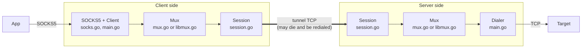
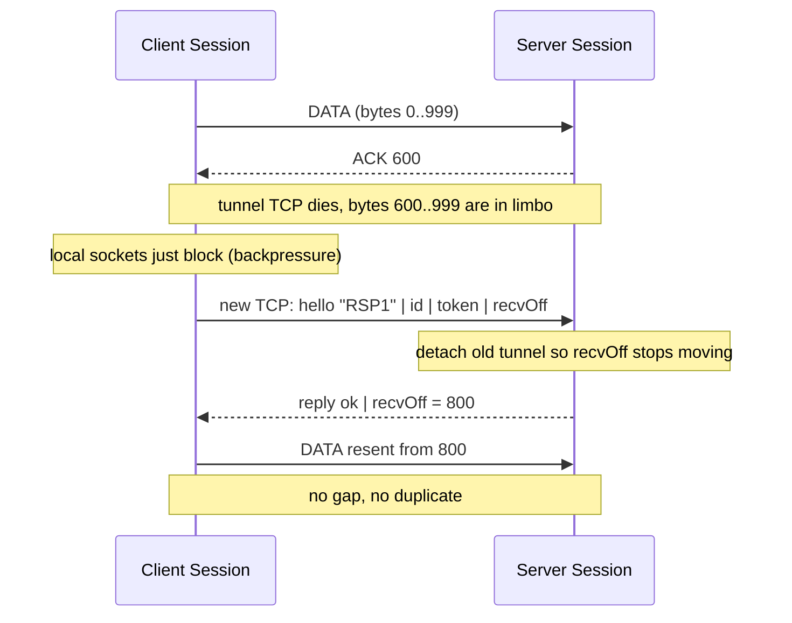
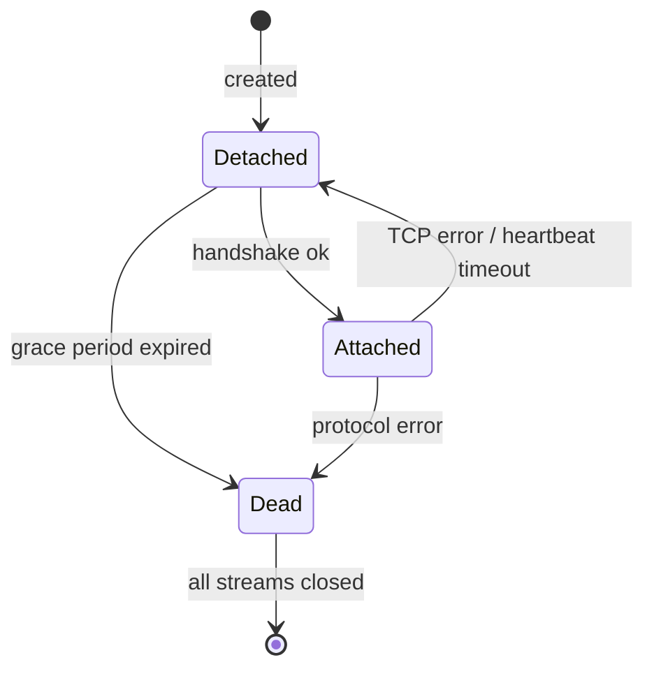
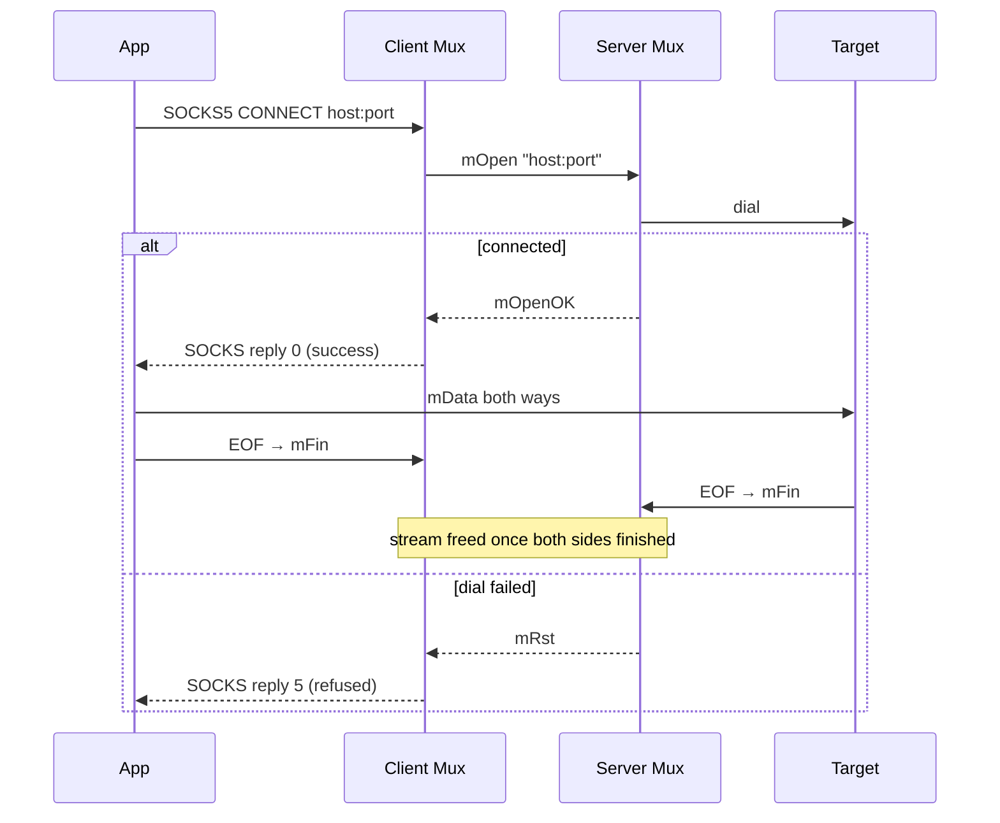

# ResumeProxy: Transparent TCP Session Recovery

An educational proof of concept: a SOCKS5 proxy whose client↔server tunnel
**survives TCP connection loss without closing the local connections**.

If the tunnel TCP connection is killed, reset, or silently blackholed, the
apps using the proxy see only a pause, never a broken connection. Once a new
tunnel connection is up, every byte continues exactly where it stopped: none
are lost, duplicated, or reordered.


> PoC only: the tunnel has no encryption or authentication. Run it inside a
> real transport (TLS, etc.).

## Architecture

The code has three layers. Each layer solves one problem and knows nothing
about the problems of the others.



| Layer   | File         | Responsibility                                                                 |
|---------|--------------|--------------------------------------------------------------------------------|
| I/O     | `uring_linux.go` | Optional: the tunnel connection's reads and writes through io_uring, selected with `-io` |
| Session | `session.go` | One reliable byte stream that outlives the TCP connection carrying it          |
| Mux     | `mux.go`     | Many proxied connections ("streams") multiplexed over one Session              |
|         | `libmux.go`  | The same job done by smux or yamux, selected with `-mux`                       |
| Front   | `socks.go`   | SOCKS5 server on the client (parses untrusted input)                           |
|         | `main.go`    | Client session holder, target dialer on the server, CLI flags                  |

The key design choice: **resumption is solved once, for the whole byte
stream**, in the Session. The Mux never sees a reconnect; to it, the Session
simply never fails unless the grace period runs out. That is also why an
off-the-shelf multiplexer can be swapped in (see
[Multiplexers](#multiplexers-custom-smux-yamux)).

## Quick start

```sh
go build -o resumeproxy .

# on the server
./resumeproxy -mode server -listen :9000

# on the client
./resumeproxy -mode client -listen 127.0.0.1:1080 -server HOST:9000

# use it
curl --socks5-hostname 127.0.0.1:1080 https://example.com
```

### Flags

| Flag         | Default          | Meaning                                                      |
|--------------|------------------|--------------------------------------------------------------|
| `-mode`      | (required)       | `client` or `server`                                         |
| `-listen`    | `127.0.0.1:1080` | SOCKS5 address (client) or tunnel address (server)           |
| `-server`    | (client only)    | Address of the proxy server                                  |
| `-mux`       | `custom`         | `custom`, `smux` or `yamux`; must be the same on both sides  |
| `-grace`     | `60s`            | How long a session is kept while the tunnel is down          |
| `-heartbeat` | `5s`             | Ping interval; the tunnel counts as dead after 3 missed      |
| `-buf`       | `4`              | Retransmit buffer per direction, in MiB                      |
| `-io`        | `std`            | Tunnel I/O: `std` (Go's netpoller) or `uring` (io_uring, Linux 5.6+) |

## Try it yourself

Watch a download survive a dead network, all on one machine. `socat` plays
the network between the proxy client and the proxy server, so killing it cuts
the tunnel.

```sh
go build -o resumeproxy .

# a target: a local web server with a 60 MiB file
mkdir -p /tmp/demo && head -c 60M /dev/urandom > /tmp/demo/big.bin
python3 -m http.server 8000 -d /tmp/demo &

# the proxy server, the "network" in front of it, and the proxy client
./resumeproxy -mode server -listen 127.0.0.1:9000 -heartbeat 1s &
socat TCP-LISTEN:9001,fork,reuseaddr TCP:127.0.0.1:9000 &
./resumeproxy -mode client -listen 127.0.0.1:1080 -server 127.0.0.1:9001 -heartbeat 1s &

# a slow download through the proxy
curl --socks5-hostname 127.0.0.1:1080 --limit-rate 5M -o /tmp/demo/copy.bin http://localhost:8000/big.bin
```

While curl runs, break the network from a second terminal:

```sh
pkill socat          # cut it: curl pauses, nothing breaks
socat TCP-LISTEN:9001,fork,reuseaddr TCP:127.0.0.1:9000 &   # restore it: curl continues
pkill -STOP socat    # blackhole: packets vanish, no FIN or RST is ever sent
pkill -CONT socat    # once the logs say "tunnel lost" (about 3 s), let traffic through again
```

Then check that nothing was lost or duplicated:

```sh
cmp /tmp/demo/big.bin /tmp/demo/copy.bin && echo identical
```

The logs show each step: when the tunnel was lost, how many bytes were still
unacknowledged, and how many were replayed after the reconnect. curl speeds up
after each pause because `--limit-rate` limits the *average* rate. On Linux
with root you can also kill the tunnel socket directly:
`sudo ss -K dport = :9000`.

## How resumption works

TCP only guarantees delivery while the connection is alive. When it dies,
bytes our kernel accepted may never have reached the peer application, and
there is no way to tell how many. So each side counts bytes at the
application layer:

- **Sender** keeps every byte in a retransmit buffer until the peer ACKs it.
- **Receiver** remembers `recvOff`, the total number of bytes received in order.
- **On reconnect** both sides exchange their `recvOff`, and each side resends
  everything after the peer's offset.

### Send-side offsets

```
        acked by peer      sent, unacked     not yet sent
  ... ───────────────┼──────────────────────┼──────────────┤
                  sendBase               sendNext    sendBase+len(sendBuf)
                     └─────────────── sendBuf ─────────────┘
```

On resume, `sendNext` is rewound to the peer's `recvOff`.

### Reconnect sequence



### Session lifecycle



When a session dies, the Mux closes every local connection, and the Client
transparently creates a fresh session for the next SOCKS request.

### Failure detection

| Failure                         | How it is detected                                         |
|---------------------------------|------------------------------------------------------------|
| Connection closed / reset       | Read or write error on the tunnel                          |
| Silent blackhole (no FIN/RST)   | No frame (not even a PING) within `Timeout` = 3 × heartbeat |
| Reconnect fails                 | Client redials with backoff: 50 ms, doubling, max 2 s       |
| Outage longer than grace period | Session is closed, local connections see EOF                |
| Server forgot the session       | Handshake is rejected and the client gives up on it         |

## Multiplexers: custom, smux, yamux

The Mux layer can be swapped with `-mux` (use the same value on both sides).
All three run over the same resumable Session, so none of them ever sees a
reconnect.

|                            | `custom` (`mux.go`)                        | `smux`                                      | `yamux`                                         |
|----------------------------|--------------------------------------------|---------------------------------------------|-------------------------------------------------|
| Code                       | about 190 lines in this repo               | [xtaci/smux](https://github.com/xtaci/smux), used by kcptun | [hashicorp/yamux](https://github.com/hashicorp/yamux), used by Consul and Nomad |
| Per-stream flow control    | No: one app that stops reading stalls every stream | Yes (protocol v2, 64 KiB window per stream) | Yes (256 KiB window per stream)                 |
| Half-close                 | `mFin` frame                               | `CloseWrite`                                | `Close` (in yamux it is a half-close)           |
| "Server reached the target" | `mOpenOK` / `mRst` frames                 | 1-byte status header from `libmux.go`       | same as smux                                    |
| Changed for resumption     | nothing                                    | keepalive off                               | keepalive off, write timeout raised, open timeout off |

**Lesson: libraries assume a live connection.** Both libraries ship keepalives
and timeouts that close the whole mux when the connection below them stalls.
Over a Session that can pause for a full grace period, every outage would
become a broken connection, which is exactly what this project prevents. So
`libmux.go` turns them off and lets the Session decide when the tunnel is
dead. One smux timeout cannot be changed: opening or closing a stream gives up
after 30 s if the Session's retransmit buffer stays full that long.

`TestSlowStreamDoesNotStallOthers` shows the flow-control difference: with
smux or yamux a second stream keeps working while the first one's app has
stopped reading. With `mux.go` the whole session stalls, so that subtest is
skipped.

## I/O backends: std, io_uring

`-io` picks how the tunnel connection (the one TCP connection between proxy
client and proxy server) does its reads and writes. Local SOCKS and target
connections always use Go's netpoller. The bytes on the wire are the same,
so each side can choose on its own.

|                  | `std` (default)                                          | `uring` (`uring_linux.go`)                                   |
|------------------|----------------------------------------------------------|--------------------------------------------------------------|
| A read waits by  | nonblocking `read`, parking the goroutine until `epoll` wakes it | one `io_uring_enter` that submits a `RECV` and waits for its completion |
| Code             | Go standard library                                      | about 290 lines of code, standard library only (`syscall`, `unsafe`) |
| Platforms        | all                                                      | Linux 5.6+, amd64 and arm64                                  |

How the `uring` backend works:

- `uringConn` implements `net.Conn`, so the Session does not know which
  backend it runs on. Right after dial or accept it takes over the socket:
  it duplicates the fd and closes the Go connection.
- Each connection has two small rings, one for reads and one for writes. The
  Session has exactly one reader and one writer goroutine, so they never
  share a queue and no reactor goroutine is needed.
- Deadlines, which the heartbeat depends on, are a `LINK_TIMEOUT` linked
  behind the read or write.
- `Close` calls `shutdown` first: closing the fd does not cancel an operation
  the kernel is already running.
- Go's scheduler interrupts threads with `SIGURG`, so `io_uring_enter` often
  returns `EINTR`. The wait loop recounts what was submitted and completed
  each time, so nothing is submitted twice.

**Lesson: io_uring is not automatically faster.** This backend still makes
one syscall per read or write, like the netpoller, and a blocking
`io_uring_enter` holds an OS thread while it waits. io_uring saves syscalls
only when many operations share one `io_uring_enter`. That needs one shared
ring for all sockets and a reactor goroutine, which this PoC leaves out. The
[benchmark](#benchmark) shows the result: about the same throughput, or a
little lower. A profile also shows the limit: the tunnel's own I/O is only
about 20% of the CPU time. The rest goes to the local, relay and target
connections, which stay on the netpoller, so even free tunnel I/O could gain
at most about 20–25%.

**Why not SQPOLL?** With `IORING_SETUP_SQPOLL` a kernel thread picks up
submissions, so submitting needs no syscall. We tried it, and it was about
30% *slower*:

| Variant (`custom` mux, compared with the plain `uring` backend) | Throughput        |
|------------------------------------------------------------------|-------------------|
| SQPOLL, one kernel thread per ring or one shared thread          | about 30% slower  |
| SQPOLL, plus spinning on the completion queue instead of waiting | about 25% slower  |
| `IORING_SETUP_COOP_TASKRUN`                                      | the same          |

- **It saves no syscall here.** Each direction has one operation in flight
  and waits for it. Today one `io_uring_enter` submits *and* waits; SQPOLL
  removes only the submit, so the wait is still a syscall.
- **It adds a hop.** The request goes from our thread to the kernel's polling
  thread on another CPU, and the completion has to wake our thread again.
  With one operation in flight, every extra microsecond of latency is lost
  throughput.
- **The polling threads compete for the CPU.** Four tunnel rings started four
  kernel threads, using cores the proxy needs. Spinning on the completion
  queue avoids the wait syscall but keeps a Go P busy, which hurt even more.

SQPOLL pays off when a program keeps many operations in flight and has spare
cores, for example a server with one ring per core.

**Docker:** the default seccomp profile blocks io_uring, so `-io uring` exits
at startup with an error. Allow it with `security_opt: [seccomp=unconfined]`
in `compose.yaml`, or with a custom profile that permits `io_uring_setup` and
`io_uring_enter`. Some systems also turn io_uring off with the
`kernel.io_uring_disabled` sysctl.

## Wire format

### Session layer (`session.go`)

| Message | Direction       | Layout                                              |
|---------|-----------------|-----------------------------------------------------|
| hello   | client → server | `"RSP1"` · id[16] · token[16] · recvOff u64         |
| reply   | server → client | status u8 (0 = ok) · recvOff u64                    |
| DATA    | both            | `0` · len u16 · payload (≤ 16 KiB)                  |
| ACK     | both            | `1` · recvOff u64                                   |
| PING    | both            | `2`                                                 |

The `token` is a secret that proves a reconnecting client owns the session;
the server compares it in constant time.

### Mux layer (`mux.go`)

Each frame is `streamID u32 · type u8 · len u16 · payload`.

| Type     | Meaning                                  |
|----------|------------------------------------------|
| `mOpen`  | Open a stream, payload is `host:port`    |
| `mOpenOK`| Server connected to the target           |
| `mData`  | Stream data                              |
| `mFin`   | Sender will write no more (half-close)   |
| `mRst`   | Stream is gone                           |



The SOCKS success reply is delayed until the server has really connected, so
the app gets a real "connection refused" instead of a fake success.

### Library streams (`libmux.go`)

smux and yamux frame the streams themselves (see their repos). They only
carry bytes, so each stream starts with a small header before the proxied
data:

| Message | Direction       | Layout                          |
|---------|-----------------|---------------------------------|
| target  | client → server | len u16 · `host:port`           |
| status  | server → client | u8 (0 = connected, else failed) |

## Tests

```sh
go test ./...
```

The tests put a misbehaving relay between client and server and push data
through a real SOCKS5 connection to an echo server. Each test runs once per
multiplexer and I/O backend as a subtest, for example
`go test -run 'Kills/yamux/uring' -v`. The `uring` subtests skip, with the
reason, where io_uring is unavailable.

| Test                                     | What it proves                                                        |
|------------------------------------------|-----------------------------------------------------------------------|
| `TestSurvivesRepeatedTunnelKills`        | 64 MiB echoed intact while the tunnel is killed every 15 ms           |
| `TestSurvivesSilentBlackhole`            | Heartbeat detects a tunnel that drops packets without FIN/RST         |
| `TestMultipleStreamsSurvive`             | 8 parallel streams survive repeated kills                             |
| `TestGraceExpiryClosesLocalThenRecovers` | Local connection closes only after grace, and new ones work afterward |
| `TestSlowStreamDoesNotStallOthers`       | A stream whose app stops reading doesn't block others (smux, yamux)   |
| `TestUringConn*`                         | io_uring connection alone: round trip, read deadline, Close wakes a pending Read |

### Benchmark

```sh
go test -run '^$' -bench Throughput
```

Echoes 8 MiB per iteration over a direct TCP connection and through the whole
proxy with each multiplexer and I/O backend. Best of 3 runs on a laptop
(i5-1235U):

| Path     | `-io std`  | `-io uring` |
|----------|------------|-------------|
| direct   | ~1440 MB/s |             |
| `custom` | ~490 MB/s  | ~455 MB/s   |
| `smux`   | ~330 MB/s  | ~325 MB/s   |
| `yamux`  | ~225 MB/s  | ~220 MB/s   |

The proxied path adds three TCP hops (proxy client, test relay, proxy server)
and several buffer copies. That costs far more than the choice of
multiplexer or I/O backend. Numbers vary from run to run, and a laptop that
throttles can halve them; compare runs taken back to back.

## Related work

The same problems, solved elsewhere:

- **[Eternal Terminal](https://eternalterminal.dev/)**: a reconnecting remote
  shell over TCP. Like this project, it buffers sent bytes and replays them
  after a reconnect.
- **[Mosh](https://mosh.org/)**: keeps a terminal alive across roaming and
  sleep, but syncs screen *state* over UDP instead of resuming a byte stream.
- **QUIC connection migration** ([RFC 9000 §9](https://www.rfc-editor.org/rfc/rfc9000#section-9)):
  connections are identified by connection IDs, not by addresses, so the
  transport itself survives a change of network path.
- **Multipath TCP** ([RFC 8684](https://www.rfc-editor.org/rfc/rfc8684)): one
  connection spread over several TCP subflows; losing one subflow does not
  break it.
- **autossh**: the opposite approach. It restarts the SSH connection, so every
  connection forwarded through it breaks.
- **HTTP/2 and QUIC streams**: multiplexing many streams over one connection
  with per-stream flow control, like smux and yamux.

## Known limitations

| Limitation                       | Effect                                                                 |
|----------------------------------|------------------------------------------------------------------------|
| No encryption / authentication   | Must run inside a secure transport. Without client authentication the server is an open proxy: anyone who reaches it can use it, including to reach the server's own localhost and LAN |
| No per-stream flow control in `mux.go` | One local socket that stops reading stalls other streams of the session; `-mux smux` and `-mux yamux` don't have this problem |
| `-mux` mismatch                  | Not detected: if client and server use different multiplexers, streams just fail |
| Server restart                   | All sessions are lost; clients start new ones                          |
| SOCKS5 subset                    | No auth, `CONNECT` only                                                |
| `-io uring`                      | Linux 5.6+ on amd64 or arm64 only; blocked by Docker's default seccomp profile; no batching, so not faster than `std` |

## License

[GPL-3.0](LICENSE).

---

Written by [Claude](https://claude.com/claude-code).
